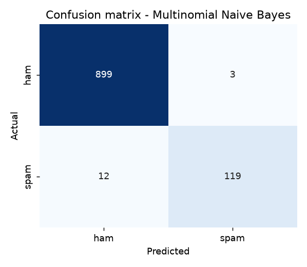

# Spam Message Classifier

A machine-learning project in Python that decides whether a text message is **spam** or **ham** (not spam).
It covers the full workflow: labeled data, text preprocessing, TF-IDF features, scikit-learn classifiers,
evaluation on unseen messages, error analysis and predictions for new messages.

**Result:** 98.5% accuracy, 0.975 spam precision and 0.908 spam recall (F1 0.941) on 1,033 unseen messages
from the SMS Spam Collection.

## Features

- Text preprocessing: lowercase, remove punctuation, numbers and stop words (keeping a few spam-signal words such as *you*, *your*, *now*)
- TF-IDF features with unigrams and bigrams
- Three models compared: Multinomial Naive Bayes, Logistic Regression, Linear SVM, tuned with 5-fold cross-validation
- Evaluation with accuracy, precision, recall, F1 and a confusion matrix, not accuracy alone (spam is only about 13% of the data)
- Error analysis of false positives and false negatives
- Command-line prediction and a simple Flask web interface
- Test-case runner that records results in the evaluation report

## Dataset

**SMS Spam Collection** (UCI Machine Learning Repository, Kaggle copy `spam.csv`): 5,572 messages, 5,161 after
removing duplicates, of which 653 (12.7%) are spam. Mostly UK English SMS from the 2000s.

`data/spam_dataset.csv` is a small **synthetic** dataset generated by `src/make_dataset.py`. It is only for quick demos
and tests. Do not judge the model by scores on that file.

## Project structure

```
spam-classifier/
├── data/
│   ├── spam.csv                Real dataset (SMS Spam Collection, Kaggle copy)
│   └── spam_dataset.csv        Synthetic demo dataset
├── notebooks/
│   └── spam_classifier.ipynb   Exploration, training and evaluation
├── src/
│   ├── preprocess.py           Text cleaning and dataset loading
│   ├── train_model.py          Trains, tunes, evaluates, saves the model, writes report and charts
│   ├── predict.py              Classifies a new message (command line and importable)
│   ├── run_tests.py            Runs the test cases and records results
│   ├── app.py                  Simple web interface (Flask)
│   └── make_dataset.py         Generates the synthetic dataset
├── models/                     Saved model and TF-IDF vectorizer
├── results/
│   ├── evaluation.md           Metrics, error analysis, before/after comparison, test cases
│   └── charts/                 Confusion matrix and other charts
├── requirements.txt
└── README.md
```

## How to run

```bash
pip install -r requirements.txt

python src/train_model.py --data data/spam.csv     # train and evaluate on the real dataset
python src/run_tests.py                            # run the test cases
python src/predict.py "You won a free prize! Click now to claim."
python src/app.py                                  # web interface at http://127.0.0.1:5000
```

`train_model.py` also accepts the original UCI file (`--data data/SMSSpamCollection`). Without `--data` it uses the
synthetic demo file. The notebook can be opened in Jupyter or Google Colab; upload the `src/` and `data/` folders
next to it and point the load cell at `../data/spam.csv`.

## Method

| Step | What is done |
|---|---|
| Cleaning | lowercase, remove punctuation and numbers, remove stop words except a small keep-list |
| Features | `TfidfVectorizer`, unigrams and bigrams, `max_features=5000`, fitted on training data only |
| Split | 80/20 `train_test_split`, `stratify=y`, `random_state=42` (4,128 train / 1,033 test) |
| Models | Multinomial Naive Bayes, Logistic Regression (balanced), Linear SVM |
| Tuning | `GridSearchCV`, 5-fold, scored on spam F1, training data only |

## Results

Spam-class metrics on unseen test messages:

| Model | Best parameters | Accuracy | Precision | Recall | F1 |
|---|---|---|---|---|---|
| **Multinomial Naive Bayes** | alpha=0.1 | 0.985 | 0.975 | 0.908 | 0.941 |
| Logistic Regression | C=10 | 0.985 | 0.932 | 0.947 | 0.939 |
| Linear SVM | C=0.3 | 0.984 | 0.925 | 0.947 | 0.936 |

Naive Bayes was selected because it has the highest F1 and the best precision. Wrongly blocking a real message is
usually worse than letting some spam through. Logistic Regression and SVM catch more spam but block more real messages.

Confusion matrix for Naive Bayes:

|  | Predicted ham | Predicted spam |
|---|---|---|
| Actual ham | 899 | 3 |
| Actual spam | 12 | 119 |



### What improved the model

| Configuration | Precision | Recall | F1 |
|---|---|---|---|
| Baseline: Naive Bayes, unigrams, default smoothing | 1.000 | 0.809 | 0.895 |
| Add bigrams | 1.000 | 0.786 | 0.880 |
| Keep spam-signal stop words | 1.000 | 0.794 | 0.885 |
| Tune smoothing with cross-validation (final) | 0.975 | 0.908 | 0.941 |

Tuning the Naive Bayes smoothing was the change that mattered most: recall rose from 0.794 to 0.908. The full table
is in `results/evaluation.md`.

## Error analysis

- **False positives (3):** short, casual messages that contain spam-like words such as "free" or "phone".
- **False negatives (12):** mostly adult or dating spam written like a personal text, very short premium-rate
  messages (a keyword plus a short code), and quiz-style premium SMS.
- Phone numbers and short codes are removed by the cleaning step, which probably costs some recall. Replacing them
  with placeholder tokens is a possible next improvement.

## Test cases

`python src/run_tests.py` runs 14 cases covering obvious spam, normal messages, empty or symbol-only input, very short
text, Hinglish, genuine promotional messages and disguised spam. **12 of 14 pass.** The two failures are Indian-style
loan spam with a link and a disguised "gift" message with no spam keywords. Both are patterns the UK-based training
data barely contains.

## Limitations

- Trained on one dataset: UK English SMS from the 2000s. Other regions, languages and newer spam styles
  (for example Indian loan or KYC phishing) are underrepresented.
- Bag-of-words models ignore context, so spam that avoids typical spam words is easily missed.
- Spammers adapt, so the model needs periodic retraining on fresh data.
- Privacy: do not train on real private messages without permission.

## Possible improvements

- Placeholder tokens for phone numbers and short codes instead of deleting numbers
- Character n-grams to handle spelling tricks such as "fr33" or "txt"
- More training data from other regions and newer spam
- Adjusting the decision threshold to trade recall against precision

## Credits

Dataset: SMS Spam Collection, UCI Machine Learning Repository (Almeida and Hidalgo), Kaggle copy.
Built with pandas, scikit-learn, matplotlib, seaborn and Flask.