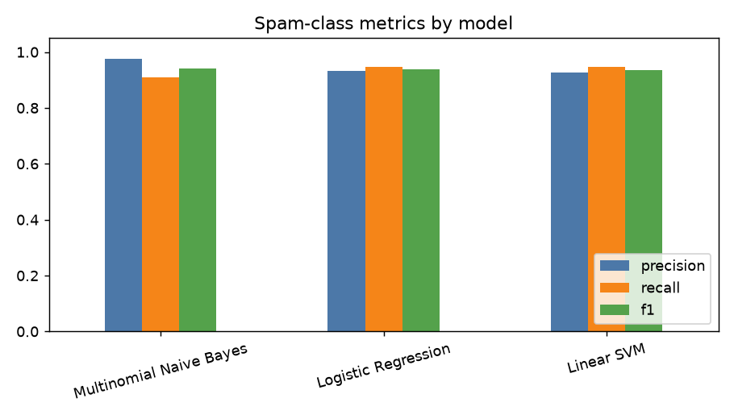
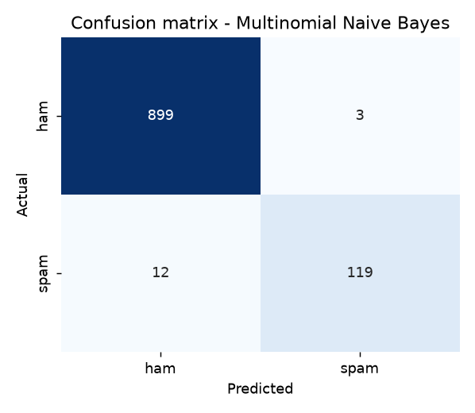
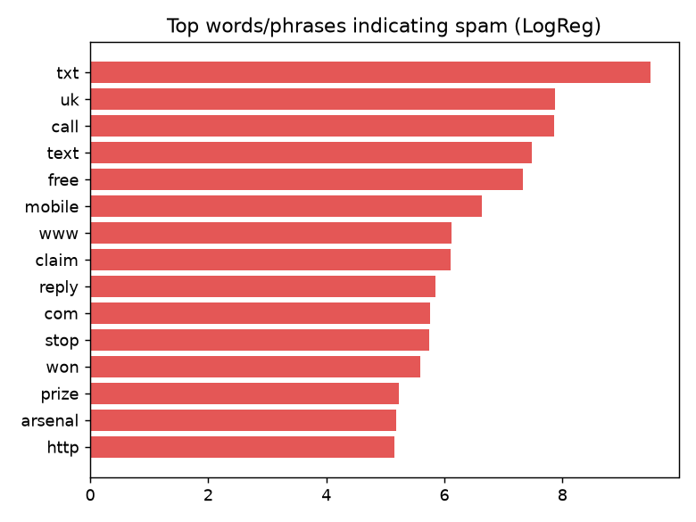

# Evaluation Report

Dataset: `spam.csv` | Split: 80% train / 20% test, stratified, random_state=42 | Features: TF-IDF, ngram_range=(1,2), max_features=5000

## Dataset summary

| Item | Value |
|---|---|
| Total messages (after cleaning) | 5161 |
| Ham | 4508 |
| Spam | 653 (12.7%) |
| Duplicates left | 0 |
| Missing values | 0 |
| Avg length ham / spam (chars) | 71 / 138 |
| Train / test size | 4128 / 1033 |


Most common words (after cleaning):

- **ham**: you (1874), u (922), me (727), my (675), s (461), not (389), m (385), your (381), t (355), we (337)
- **spam**: call (322), you (270), å£ (247), your (242), free (197), now (168), p (157), u (156), txt (141), ur (119)

## Model comparison (metrics are for the spam class, on unseen test data)

| Model | Best params (5-fold CV) | Accuracy | Precision | Recall | F1 |
|---|---|---|---|---|---|
| Multinomial Naive Bayes | {'alpha': 0.1} | 0.985 | 0.975 | 0.908 | 0.941 |
| Logistic Regression | {'C': 10} | 0.985 | 0.932 | 0.947 | 0.939 |
| Linear SVM | {'C': 0.3} | 0.984 | 0.925 | 0.947 | 0.936 |


**Selected model: Multinomial Naive Bayes** (highest spam F1; saved to `models/`).



## Classification report (selected model)

```
              precision    recall  f1-score   support

         ham      0.987     0.997     0.992       902
        spam      0.975     0.908     0.941       131

    accuracy                          0.985      1033
   macro avg      0.981     0.953     0.966      1033
weighted avg      0.985     0.985     0.985      1033
```

## Confusion matrix (selected model)

|  | Predicted ham | Predicted spam |
|---|---|---|
| Actual ham | 899 | 3 |
| Actual spam | 12 | 119 |




## Error analysis

- False positives (real message marked spam): **3**
- False negatives (spam missed): **12**
- Share of messages with 5 words or fewer: all test 12%, false positives 33%, false negatives 8%
- Which error matters more? Blocking a real message (false positive) is usually worse, so precision is watched closely, but low recall lets spam reach users.

### False positives

- `* Will have two more cartons off u and is very pleased with shelves`
- `Can... I'm free...`
- `Can u get pic msgs to your phone?`

### False negatives

- `Missed call alert. These numbers called but left no message. 07008009200`
- `Hi its LUCY Hubby at meetins all day Fri & I will B alone at hotel U fancy cumin over? Pls leave msg 2day 09099726395 Lucy x Callså£1/minMobsmoreLKPOBOX177HP51FL`
- `In The Simpsons Movie released in July 2007 name the band that died at the start of the film? A-Green Day, B-Blue Day, C-Red Day. (Send A, B or C)`
- `Babe: U want me dont u baby! Im nasty and have a thing 4 filthyguys. Fancy a rude time with a sexy bitch. How about we go slo n hard! Txt XXX SLO(4msgs)`
- `Check Out Choose Your Babe Videos @ sms.shsex.netUN fgkslpoPW fgkslpo`
- `Can U get 2 phone NOW? I wanna chat 2 set up meet Call me NOW on 09096102316 U can cum here 2moro Luv JANE xx Callså£1/minmoremobsEMSPOBox45PO139WA`
- `Hi babe its Jordan, how r u? Im home from abroad and lonely, text me back if u wanna chat xxSP visionsms.com Text stop to stopCost 150p 08712400603`
- `Want explicit SEX in 30 secs? Ring 02073162414 now! Costs 20p/min`
- `ringtoneking 84484`
- `Hi if ur lookin 4 saucy daytime fun wiv busty married woman Am free all next week Chat now 2 sort time 09099726429 JANINExx Callså£1/minMobsmoreLKPOBOX177HP51FL`
- `FreeMsg Hey U, i just got 1 of these video/pic fones, reply WILD to this txt & ill send U my pics, hurry up Im so bored at work xxx (18 150p/rcvd STOP2stop)`
- `88066 FROM 88066 LOST 3POUND HELP`

## Improving the model (before vs after)

| Configuration | Accuracy | Precision | Recall | F1 | Spam prob. of 2 obvious spam examples |
|---|---|---|---|---|---|
| 1. Baseline: all stop words removed, NB alpha=1, unigrams | 0.976 | 1.000 | 0.809 | 0.895 | 0.95 / 0.63 |
| 2. + bigrams | 0.973 | 1.000 | 0.786 | 0.880 | 0.93 / 0.52 |
| 3. + keep spam-signal words (you, your, now, ...) | 0.974 | 1.000 | 0.794 | 0.885 | 0.93 / 0.62 |
| 4. + CV-tuned alpha (final Naive Bayes) | 0.985 | 0.975 | 0.908 | 0.941 | 1.00 / 0.95 |
| 5. Logistic Regression without class weights | 0.965 | 0.990 | 0.733 | 0.842 | 0.84 / 0.47 |
| 6. Logistic Regression with class_weight=balanced (C=1) | 0.977 | 0.879 | 0.947 | 0.912 | 0.96 / 0.77 |


## Top words that indicate spam (Logistic Regression)

`txt` (9.49), `uk` (7.87), `call` (7.86), `text` (7.48), `free` (7.33), `mobile` (6.64), `www` (6.13), `claim` (6.10), `reply` (5.85), `com` (5.76), `stop` (5.75), `won` (5.60), `prize` (5.23), `arsenal` (5.19), `http` (5.15)


Top words that indicate ham: `me`, `my`, `home`, `ok`, `yup`, `later`, `road`, `gt`, `call you`, `call me`



## Limitations

- Trained on one dataset (SMS Spam Collection: mostly UK English SMS from the 2000s). Other regions, languages and newer spam styles (e.g. Indian loan or KYC phishing) are underrepresented.
- Bag-of-words models ignore context; spam that avoids typical spam words is easily missed.
- Spammers adapt, so the model needs periodic retraining on fresh data.

## Step 11: Test with new messages

Result: **12/14** passed.

| Test Case ID | Scenario | Message | Expected | Actual | Result |
|---|---|---|---|---|---|
| TC_SPAM_01 | Classify an obvious spam message | `You won a free prize! Click now to claim.` | spam | spam | Pass |
| TC_SPAM_02 | Classify a normal personal message | `Are we meeting at 5 pm today?` | ham | ham | Pass |
| TC_SPAM_03 | Enter an empty message | `(empty)` | no_prediction | no_prediction | Pass |
| TC_SPAM_04 | Whitespace-only message | `(empty)` | no_prediction | no_prediction | Pass |
| TC_SPAM_05 | Only symbols / numbers | `!!! ??? 12345` | no_prediction | no_prediction | Pass |
| TC_SPAM_06 | Phishing: blocked account | `Urgent! Your account is blocked. Verify your details immediately.` | spam | spam | Pass |
| TC_SPAM_07 | Normal request for notes | `Please send me the notes from yesterday's class.` | ham | ham | Pass |
| TC_SPAM_08 | Very short ham | `ok` | ham | ham | Pass |
| TC_SPAM_09 | Very short spam | `WINNER! Claim prize now` | spam | spam | Pass |
| TC_SPAM_10 | Hinglish ham | `Kal library pe milte hain, 5 baje.` | ham | ham | Pass |
| TC_SPAM_11 | Loan spam | `Get a loan of Rs 50000 approved in 5 minutes! Apply: bit.ly/3xFr9Q` | spam | ham | Fail |
| TC_SPAM_12 | Genuine promotional (order update) | `Your order has shipped and will arrive tomorrow. Track it in the app.` | ham | ham | Pass |
| TC_SPAM_13 | Genuine message with spam-like words | `I won the match today! Are you free for dinner after?` | ham | ham | Pass |
| TC_SPAM_14 | Disguised spam, no URL | `Hello dear, I have a gift for you. Reply to know more.` | spam | ham | Fail |
